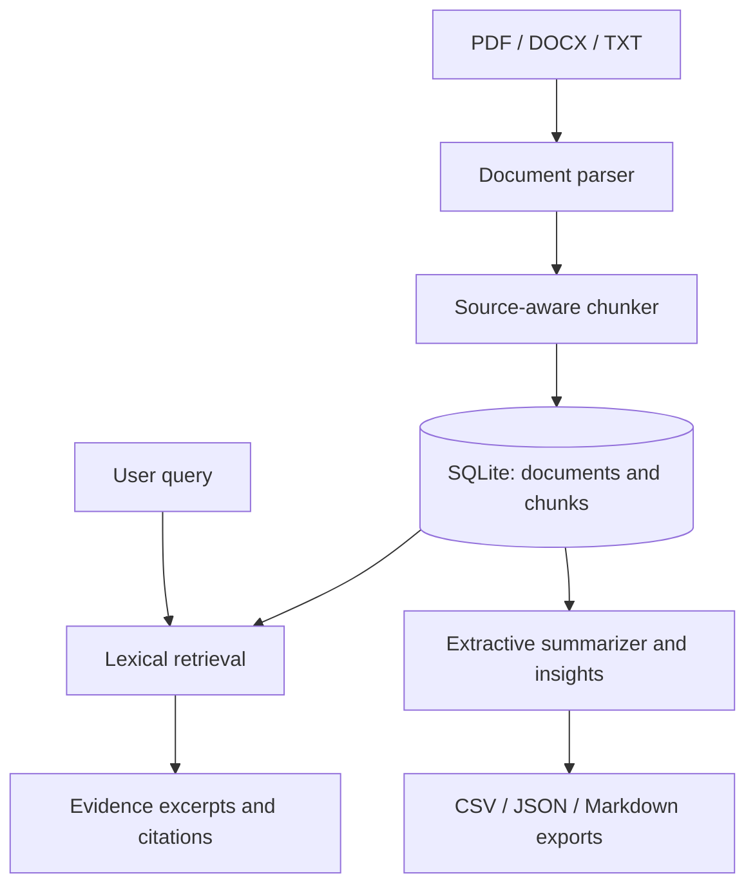

<<<<<<< HEAD
# DocuMind AI

**AI-Powered Document Analyzer and Intelligent Question Answering System** — a local-first Streamlit application for importing documents, reading extracted text, searching passages, generating extractive summaries, exploring text statistics, and exporting reports.

> Implementation honesty: this packaged build implements PDF/DOCX/TXT ingestion, SQLite persistence, chunked source-aware text storage, lexical retrieval, evidence excerpts, extractive summaries, text statistics, CSV/JSON/Markdown exports, and ten pages. It does **not** currently implement embedding vectors, FAISS, Gemini generation, OCR, authentication, or a trained topic/NER model. The UI labels these limitations instead of presenting them as active features.

## Features

- Ten pages: Dashboard, Upload Documents, Document Library, Document Reader, AI Summarizer, Ask Your Documents, Semantic Search, Document Insights, History & Reports, Settings & Status.
- PDF page references preserved when extractable; DOCX/TXT use section references instead of fabricated page numbers.
- Upload validation, duplicate detection, 20 MB per-file limit, and safe generated internal filenames.
- SQLite database with foreign keys and persistent document chunks, activities, searches, and summaries.
- Local lexical search and conservative evidence retrieval. When evidence is weak, the app says it cannot answer sufficiently.
- Extractive summaries selected from actual source sentences, with methodology disclosed.
- Local file and data storage; no API key required for core features.

## Architecture



## Folder structure

```text
DocuMind-AI/
├── app.py
├── pages/                 # Ten Streamlit pages
├── components/            # Shared theme and navigation
├── services/              # Parsing, ingestion, retrieval, summaries, reports
├── database/              # SQLite initialization and schema
├── tests/                 # Core tests
├── data/uploads/           # Local original documents (ignored by Git)
├── data/index/             # Reserved for future vector index
├── requirements.txt
├── .env.example
└── README.md
```

## Windows / VS Code setup

Use Python 3.13 and run commands from the extracted **DocuMind-AI** folder (the folder containing `app.py`).

```powershell
py -3.13 -m venv .venv
.\.venv\Scripts\Activate.ps1
python -m pip install --upgrade pip
python -m pip install -r requirements.txt
streamlit run app.py
```

If PowerShell blocks activation, use this for the current terminal only:

```powershell
Set-ExecutionPolicy -Scope Process -ExecutionPolicy Bypass
.\.venv\Scripts\Activate.ps1
```

If `py -3.13` is unavailable, check `py --list` and use an installed Python version supported by Streamlit and the pinned packages. If port 8501 is occupied, run `streamlit run app.py --server.port 8502`.

## Demo workflow

1. Start the application and open the local URL shown in the terminal.
2. Upload a text-based PDF, DOCX, or TXT file.
3. Open Document Library and inspect status/metadata.
4. Read extracted passages in Document Reader.
5. Search for a term or ask a question in Ask Your Documents.
6. Generate a concise/detailed/executive extractive summary.
7. Review counts and frequent terms in Document Insights.
8. Export inventory, activity, or extracted text from History & Reports.
9. Restart the app; records remain in `data/documind.sqlite3`.

## Tests

```powershell
python -m unittest discover -s tests -v
```

Tests cover TXT parsing, empty text, chunk source-reference preservation, tokenization, and basic insight statistics. The test suite does not replace a full manual integration test of the Streamlit UI.

## Data and privacy

Documents and the SQLite database remain under the local project directory. Keep this directory private if documents are confidential. The current build does not send text to external providers. `.env` is ignored by Git and `.env.example` contains placeholders only.

## Limitations and future work

- Scanned PDF OCR is not included.
- Search is lexical token overlap, not embedding-based semantic search; the page labels this clearly.
- Summaries are extractive sentence rankings, not generated summaries.
- Gemini API integration, sentence-transformer embeddings, FAISS indexing, entity recognition, clustering, and evaluation benchmarks remain future enhancements.
- There is no authentication or multi-user access control; do not expose the local app to an untrusted network.
- The current source-citation UX shows genuine chunk references; answer synthesis is intentionally conservative and does not claim unsupported statements are verified.

## Troubleshooting

- **Python not found:** run `py --list` and install Python 3.13 if needed.
- **Dependency installation fails:** upgrade pip, confirm internet connectivity, and retry inside `.venv`.
- **Upload rejected:** only PDF, DOCX, and TXT are supported; each file must be non-empty and at most 20 MB.
- **PDF has no text:** it may be scanned; OCR is not included.
- **Duplicate upload:** identical file bytes are detected and not added twice.
- **Database error:** stop Streamlit, back up `data/documind.sqlite3`, and restart. Do not delete the database unless you intend to erase saved records.
- **No search results:** try terms that appear in the source text; the current retrieval is lexical rather than semantic.
=======
# document_analyzer
>>>>>>> 86f825d3382150cc3809d667a2c74ebb78b22b5e
